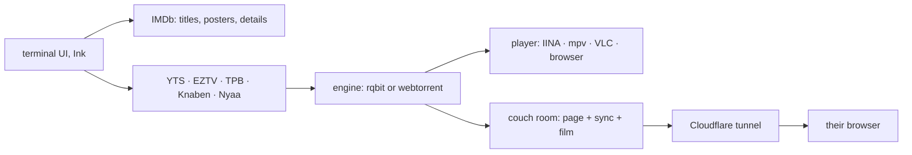

```
 ███████╗██╗     ██╗ ██████╗██╗  ██╗
 ██╔════╝██║     ██║██╔════╝██║ ██╔╝
 █████╗  ██║     ██║██║     █████╔╝
 ██╔══╝  ██║     ██║██║     ██╔═██╗
 ██║     ███████╗██║╚██████╗██║  ██╗
 ╚═╝     ╚══════╝╚═╝ ╚═════╝╚═╝  ╚═╝
```

<div align="center">

### `SEARCH IT // PICK IT // WATCH IT NOW`

*a cinema lobby in your terminal: posters, torrents, and a couch for two people in two cities*


-FF3DCB?style=flat-square&labelColor=111111)


</div>

---

## 🎬 What is this

flick is a full-screen terminal app for watching films and shows. It opens on a wall of posters (what you were watching, what is trending), you type to search IMDb, and opening a title lists torrent sources from five sites with one marked as the sensible pick. Press enter and it streams into IINA, mpv, VLC or your browser while it downloads, so the film starts in seconds instead of after the whole file arrives.

`flick couch` is the other half. Two people, two places, one film: flick serves a room page, the play/pause/seek sync and the film itself from your computer through a Cloudflare tunnel, and prints a link. The other person opens it in a desktop browser and that is their entire setup. It replaced a video call with screen sharing, which was slow, hot, and loud enough to hear over the film.

```console
nick@flick:~$ flick couch
[✓] room open: https://couch.example.com/r/9bc1zqc97c
[i] kat joined. the laptop fan did not.
```

## 🍿 The lobby

| | feature | what it actually does |
|---|---|---|
| 01 | **poster wall** | real posters through the kitty graphics protocol (kitty, Ghostty), title cards everywhere else |
| 02 | **search first** | titles from IMDb, then sources from YTS and EZTV (matched by IMDb id), The Pirate Bay, Knaben and Nyaa |
| 03 | **the pick** | 1080p, x264, under 6 GB, most seeders. the 86 GB remux is still there, just not first |
| 04 | **shows and anime** | seasons, episodes, watched marks, and which one is next |
| 05 | **couch** | a browser room both people sit in; play, pause and seek stay in step, and flick tells you if your upload keeps up |
| 06 | **pluggable** | engine rqbit or the built-in webtorrent, player IINA, mpv, VLC or the browser |
| 07 | **cache with a cap** | 10 GB by default, least recently watched goes first, nothing seeds after a film closes |
| 08 | **no ratings** | on purpose. you are about to watch it anyway |

## 🚀 Run it

Node 22 or newer. rqbit (`brew install rqbit`) and IINA or mpv are optional and better; without them flick uses its built-in engine and your browser.

```bash
npx @nitrimandylis/flick              # run once, nothing installed
npm i -g @nitrimandylis/flick         # or: bun add -g @nitrimandylis/flick
flick
flick couch
man flick
```

Type a title, press enter twice, and the film is playing. The second enter is the one you will regret at 2 am.

### Couch on a fixed address

A room gets a new random `trycloudflare.com` address each run. For one that never changes (a bookmark the other person keeps), create a named Cloudflare tunnel routed to `http://127.0.0.1:8765` and put its token and hostname in `~/.config/flick/config.json` as `tunnelToken` and `tunnelHost`. The token is a secret, so it lives only in that file.

### For agents

[`flick-cli/SKILL.md`](flick-cli/SKILL.md) is an agent skill. It covers setup, the couch tunnel, and the traps. flick is interactive from top to bottom, so the skill tells an agent to hand the user the command rather than run it: only `flick --help` and `flick --version` are safe from a tool call. Copy the directory into your agent's skills folder to install it.

## 🔩 Under the hood



| layer | path | job |
|---|---|---|
| cli | `src/cli.tsx` | arguments, help, picks the engine and player, starts the UI |
| ui | `src/ui.tsx`, `src/look.tsx` | the lobby, episodes, sources and playing screens; marquee, film strip, badges |
| posters | `src/poster.ts` | kitty graphics through Unicode placeholders, poster-tinted accents |
| titles | `src/titles.ts`, `src/anime.ts` | IMDb search, details, seasons, episodes; AniList for anime |
| sources | `src/torrents.ts` | the five sites, the pick, quality parsing, what a browser can play |
| engines | `src/engines.ts` | rqbit over its HTTP API, or webtorrent in process |
| couch | `src/couch.ts`, `src/room.ts`, `src/tunnel.ts`, `room/` | the room server, the sync rules, the tunnel, the page she opens |

**Stack:** TypeScript · Ink · Node 22 · ws · webtorrent · cloudflared · Bun for builds and tests

## 🙏 Credits

flick's list of torrent sources follows the one curated by [torlink](https://github.com/baairon/torlink) (bairon.dev, MIT), and its search-first terminal UI took inspiration from torlink's.

---

<div align="center">

**[Nick Trimandylis](https://github.com/nitrimandylis)**

`THE FILM STARTS WHEN YOU DO`

MIT licensed.

</div>
